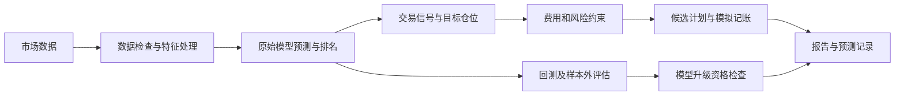

# 观澜量化｜A股研究与交易决策系统

公开项目名为 **GuanlanQuant（观澜量化）**，Python 包和本地运行目录沿用 **AshareQuant / `asharequant`**，保持现有导入、服务和账本路径兼容。

面向 A 股的本地量化研究、预测、风险管理与模拟交易系统。持续观察 20–50 只股票，以主板为主，把行情、模型判断、交易成本和仓位约束整理成可追溯的分析报告。

它不是“保证赚钱”的选股工具。与普通行情软件相比，本项目重点是记录每次预测、验证预测是否有效、比较策略并持续模拟记账。使用者可以查看判断依据和不交易原因，开发者可以复现计算和测试。

## Start here (首页入口)

[Quick start (安装与启动)](#快速开始) · [File guide (文件说明)](docs/FILE_GUIDE.md) · [Architecture (架构)](docs/ARCHITECTURE.md) · [Security (安全说明)](docs/SECURITY.md) · [Validation (验证记录)](docs/VALIDATION.md)

| Root file (根目录文件) | Purpose (用途) |
|---|---|
| [README.md](README.md) | 项目首页：功能、安装、运行与限制；GitHub 自动在仓库首页展示全文 |
| [requirements.txt](requirements.txt) | 安装 Python 基础依赖使用的清单 |
| [AGENTS.md](AGENTS.md) | 项目维护规则：修改代码时同步说明、分类与测试 |

这三个文件在桌面项目根目录直接显示，与下面的十个分类入口并列。安全与其他详细说明保留在 `docs/`，通过本页直达。

## Workspace navigation (分类入口)

GitHub 与桌面使用同一套 **00–09 分类顺序**。点击下表或仓库顶部同名文件夹，即可阅读用途并打开对应程序。公开页面只链接审核过的源码、模板和说明；账户、密钥、账本、报告及备份留在本机。

| Category (分类) | Open here for (用途) |
|---|---|
| [00_Start_Here (使用入口)](00_Start_Here%20%28%E4%BD%BF%E7%94%A8%E5%85%A5%E5%8F%A3%29/README.md) | 项目用途、安装方法与文件说明 |
| [01_Reports (报告与收益)](01_Reports%20%28%E6%8A%A5%E5%91%8A%E4%B8%8E%E6%94%B6%E7%9B%8A%29/README.md) | 报告生成、收益展示与中文阅读功能 |
| [02_Source (程序源码)](02_Source%20%28%E7%A8%8B%E5%BA%8F%E6%BA%90%E7%A0%81%29/README.md) | 按数据、预测、决策、风险、模拟执行顺序查看全部程序 |
| [03_Configuration (配置)](03_Configuration%20%28%E9%85%8D%E7%BD%AE%29/README.md) | 公开配置模板与初始化说明 |
| [04_Data (数据与账本)](04_Data%20%28%E6%95%B0%E6%8D%AE%E4%B8%8E%E8%B4%A6%E6%9C%AC%29/README.md) | 数据获取、数据库与账户账本实现；私人数据不上传 |
| [05_Operations (运行与诊断)](05_Operations%20%28%E8%BF%90%E8%A1%8C%E4%B8%8E%E8%AF%8A%E6%96%AD%29/README.md) | 每日运行、盘中服务、健康检查及本地提醒 |
| [06_Tests_and_Tools (测试与工具)](06_Tests_and_Tools%20%28%E6%B5%8B%E8%AF%95%E4%B8%8E%E5%B7%A5%E5%85%B7%29/README.md) | 自动化测试、初始化与维护工具 |
| [07_Documentation (说明文档)](07_Documentation%20%28%E8%AF%B4%E6%98%8E%E6%96%87%E6%A1%A3%29/README.md) | 架构、文件指南、运行、安全及验证说明 |
| [08_Archives_and_Backups (历史与回滚)](08_Archives_and_Backups%20%28%E5%8E%86%E5%8F%B2%E4%B8%8E%E5%9B%9E%E6%BB%9A%29/README.md) | 归档与恢复功能；本机历史备份不上传 |
| [09_Environment (环境与依赖)](09_Environment%20%28%E7%8E%AF%E5%A2%83%E4%B8%8E%E4%BE%9D%E8%B5%96%29/README.md) | 依赖版本、环境要求与 Git 排除规则 |

GitHub 展示的是完整功能源码；新下载的项目不会包含你的已配置账户、已安装服务或历史运行结果。程序实际路径保持兼容，因此仓库仍保留 `asharequant/`、`config/` 等底层目录。十个分类页均为导航入口，不复制另一套程序。

桌面分类、GitHub 分类页和文件说明由同一份 [`config/workspace_layout.json`](config/workspace_layout.json) 维护。运行 `python scripts/organize_workspace.py --root . --apply` 可生成本地分类；只有每类的 `README.md` 可以提交，其他本地链接与清单保持忽略。详见 [Workspace guide (工作区指南)](docs/WORKSPACE_LAYOUT.md)。

## 能做什么

| 能力 | 代码状态与边界 |
|---|---|
| 历史数据、行情更新与完整性检查 | 已实现；接口可用性和数据时效需逐次检查 |
| 收益预测及 1/5/20 交易日期限分析 | 已实现；缺数据或验证不足会明确标记 |
| 七项指标及九因素评分 | 已实现；预测收益、上涨概率、波动率、下行风险、区间、不确定性、评分；研究概率不等于已校准概率 |
| 四类组合方法 | 等权、风险平价、均值方差、约束评分；是否可正式启用仍由验证决定 |
| 费用、现金、T+1、交易单位及状态检查 | 已实现；目标仓位与可执行候选计划分开 |
| 历史回测、样本外验证与模型迭代 | 已实现；候选失败时保留原模型，不保证每日升级 |
| 连续模拟账户与收益统计 | 已实现；当前只展示动态模拟主账户，旧账本仅留历史证据，不动真实资金 |
| 盘中走势、新闻/公告辅助研究 | 已实现研究路径；使用行情与有时间标记的事件，新闻主要为标题/摘要规则，不等于完整公告语义分析 |
| 每日总览与详细报告 | 已实现；默认展示当前策略主账户、研究计划、验证结果和收益记录，旧策略仅保留内部证据 |
| 定时任务 | 有本地调度入口；安装代码不会自动注册服务，运行电脑须保持可用 |
| 券商持仓 | 支持导出记录/账户快照导入；不代表实时券商连接 |
| 真实自动下单 | **未实现、未启用**；当前程序没有真实券商下单通道 |

开发中/待完善：跨机器部署验收、数据接口稳定性、模型长期前瞻验证、模块化迁移。实时券商接入和实盘执行属于后续独立工作，不能把模拟成交当成券商成交。

## 工作原理



原始预测与决策层分开：改变仓位预算不应改变模型预测值。当前默认使用一套动态模拟主账户；旧账本仅保留内部依赖与历史证据，不叠加收益。正式模型资格不因模拟收益好就自动获得。

## 项目目录

```text
asharequant/
  data_sources/       数据库及券商导出记录处理
  models/             原模型函数的公共入口
  strategies/         下一交易日计划
  risk/               独立风险控制计划
  backtesting/        历史研究与回测
  evaluation/         预测质量、验证准备和数据连接检查
  reporting/          总览、详细报告和持仓摘要
  forecast.py         保留路径的特征与收益预测核心
  decision.py         组合分配和交易约束
  lifecycle.py        Champion–Challenger 验证与迭代
  dynamic_service.py  当前动态模拟主服务
  intraday_inference.py 原参数盘中研究推理
  order_engine.py     模拟委托、后续报价撮合与账本
  intraday.py         旧盘中对照及内部兼容
  adaptive_intraday.py 旧动态账本与迁移证据
  cli.py              命令入口
  daily.py            每日流水线
  scheduler.py        北京时间调度
config/               非敏感配置模板
  environments/       历史研究环境的依赖版本记录
scripts/              初始化等维护入口
tests/                自动化测试
docs/                 架构与安全说明
tools/                数据对比、历史验收与决策示例
requirements.txt      基础安装依赖（首页保留）
```

部分核心实现保留原路径，因为模型和模拟账本用源码指纹核验版本。旧导入入口保留兼容；不应仅凭文件名相似就删除。完整对应关系见 [代码导航](docs/ARCHITECTURE.md)。

## 快速开始

建议 macOS/Linux、Python 3.11。文件锁使用 `fcntl`，原生 Windows 尚未支持。以下测试使用既有 Python 环境验证；全新机器的完整依赖安装及所有网络接口不能据此宣称已验收。

```bash
git clone https://github.com/zhengbowei0096-bot/GuanlanQuant.git
cd GuanlanQuant
python3.11 -m venv .venv
source .venv/bin/activate
python -m pip install -r requirements.txt
python scripts/init_config.py
python -m asharequant.cli --help
python -m unittest discover -s tests
```

初始化只生成缺少的本地文件，不覆盖已有配置。`watchlist.csv` 示例股票默认禁用；请准备自己的有效观察池并核实上市日期、交易状态与数据覆盖。账户、费率和凭据放本地，不能提交 Git。模板不包含任何真实持仓或真实账户。动态模板初始化为 `dynamic_config.json`，默认关闭；不要直接在空仓库开启，先阅读 [运行前提](docs/DYNAMIC_EXECUTION.md)。

运行入口（在项目目录执行）：

```bash
# 检查已有数据，不等于自动补齐
python -m asharequant.cli check --root .
# 获取数据并执行既有研究流程，需要网络和有效观察池
python -m asharequant.cli run --root .
# 运行每日流程：受北京时间及交易日限制
python -m asharequant.cli daily --root .
# 检查最近完整交易日流程，会产生本地记录
python -m asharequant.cli daily-verify --root .
```

更多入口使用 `--help` 查看，包括 `forecast`、`decision`、`portfolio-validate`、`lifecycle`、`paper-account`、`active-research`、`connection-health`。训练研究依赖可参考 `config/environments/requirements-models.lock.txt` 和 `config/environments/requirements-risk-models.lock.txt`；这些是已有环境版本记录，不保证任意平台均可安装。

## Maintenance tools (维护与验收工具)

常用数据更新和检查统一从项目根目录运行：

```bash
python -m asharequant.cli run --root .
python -m asharequant.cli check --root .
python -m tools.compare_sources
```

| File (文件) | Purpose and prerequisites (用途与前提) |
|---|---|
| [tools/compare_sources.py](tools/compare_sources.py) | 对比保留的历史数据来源；需要本地观察池和原始快照，不会启动实时盯盘 |
| [tools/verify_factors.py](tools/verify_factors.py) | 历史因子验收；包含固定观测日期与特征数量假设，可能更新因子数据并写报告 |
| [tools/verify_models.py](tools/verify_models.py) | 核对已有模型对比报告、时间划分和预测重放，需要本地研究结果 |
| [tools/verify_risk_models.py](tools/verify_risk_models.py) | 核对风险模型报告、影子记录和旧账户快照，属于历史验收工具 |
| [Environment versions (环境版本记录)](config/environments/) | 三份历史阶段依赖清单，保留原版本供复现；日常安装仍用根目录 requirements.txt |

历史验收工具使用 `python -m tools.verify_factors`、`python -m tools.verify_models` 或 `python -m tools.verify_risk_models`，在已准备对应数据的项目根目录运行。它们会运行测试并生成本地证据，有历史特定假设，不是每天必须执行的启动器，也不代表当前模型已经验收。

已移除四个无独立逻辑、且未被现有自动任务调用的重复入口：`check_data.py` 改用 `cli check`；`market_data.py`、`market_data_tx.py`、`update_watchlist.py` 改用 `cli run`。完整命令见上方；删除的是转发入口，其调用的数据、预测与交易功能保留。旧版本可由 Git 或本机变更备份恢复。

## 每日与盘中工作

每日流程包括历史刷新、分析、模拟账户处理、模型生命周期检查、严格验证、组合验证、执行重放、模型监测、预测质量审计及连接检查。北京时间 18:00 后按交易日执行；失败阶段会留下记录。定时服务属于本地部署配置，不随公开源码打包。

盘中服务按既有配置刷新行情（当前支持 30 秒轮询）；动态研究使用短时价格走势、相对表现、波动和事件信息修正模拟决策。事件有发布时间和首次观察时间，陈旧或无法确认的信息会限制行动。30 秒轮询不等于交易所实时专线。

电脑关机、休眠、断网或登录服务未启动时不能保证执行。每日报告包含流程状态；“生成报告”不代表所有数据与模型均通过验证。

## 如何阅读结果

- **预测收益率**：指定未来交易日期限的估计，不能当成确定收益。
- **上涨概率**：区分研究估计与独立校准通过状态；未知不填造假的 50%。
- **波动率、下行风险、区间与不确定性**：表示可能变化范围与模型可信程度，不是止损保证。
- **评分和排名**：观察池内相对比较；最高分不代表一定值得买。
- **目标仓位**：研究配置目标，不是当前仓位最优的证明。
- **BUY/ADD/HOLD/REDUCE/SELL/WAIT/NO_TRADE**：依报告路径显示买入、加仓、持有、减仓、卖出、观望或不可执行；必须同时读原因、股数与执行条件。
- **模拟收益**：按该账本的成交假设、费用和估值计算；没有发生真实资金交易。不同模拟账本不可混算。
- **回测指标**：年化收益、夏普、最大回撤、波动、换手、成本等需结合样本外结果，不可只看收益。

报告主要位于本地 `reports/`，状态/预测/账本位于 `data/`；桌面导出位置由本地报告配置决定。网页可能包含私人持仓，不能作为公开演示直接上传。

## 数据与验证边界

代码包含 AkShare、腾讯、新浪、BaoStock 等数据路径及可选数据源配置。各接口用于不同历史、行情或交叉检查任务，不保证每个来源随时可用。新闻/公告辅助研究不保证全量覆盖或即时发布。行情价格应连同来源和时间一起解释。

回测与候选模型验证采用时间序列划分、成本评估和风险检查；实现这些机制不代表某模型已经通过。前瞻验证必须等真实预测到期，不能用回填记录假装积累。正式升级失败就保留旧模型。

## 常见问题

- 缺少 `config.json`：先运行初始化脚本；不要复制他人的私人账户配置。
- 没有可分析股票：示例观察池禁用，请配置自己的股票并检查数据完整性。
- 报告不交易：查看净预期收益、费用、流动性、资金、状态、模型资格等限制原因，不能为了交易取消校验。
- 接口或 TLS 失败：检查网络、上游变化和本地证书，不关闭证书验证。
- 没有自动运行：检查本地调度服务、北京时间、交易日和电脑是否休眠；源码存在不代表服务已安装。
- 导入失败：从仓库根目录运行，确认使用安装了依赖的同一个 Python 环境。

## 风险、维护与许可证

数据可能错误或延迟，模型可能过拟合，费用和滑点可能吞掉小额交易优势，极端行情可能无法成交。项目旨在提供可审计的研究，不承诺收益，也不承诺每天模型变好。

本次整理保留原算法、风险参数与交易规则。新增分组通过兼容入口连接；有疑问的历史文件保留，缓存删除前备份。后续重点是部署可重复性、长期前瞻评估和版本指纹迁移，避免用重构使历史记录失效。

仓库当前未指定开源许可证；公开可见不等于授予任意再分发许可。详情见 [安全与发布说明](docs/SECURITY.md)。

整理验收和恢复说明见 [验证记录](docs/VALIDATION.md)。


桌面报告保留规则：每个行情日期仅保留最后一次完整生成的报告，按带时区的生成时间判断。新报告完成归档后，较早的桌面副本移入本地 backups/desktop_report_versions，供恢复；不删除预测记录、模拟成交或收益账本。遇到不完整报告先停止清理。


当前展示规则：每日总览与桌面仅展示当前新策略，旧策略对照报告入口移除。后台历史账本及新策略依赖的基准数据保留，用于审计和计算；隐藏报告不代表停止全部内部对照计算，不修改原始收益记录。

### 行情驱动研究模拟（2026-10-21）

当前可选执行层是 `dynamic_service`：每30秒获取腾讯/新浪公开报价，检查时间、交叉来源和当日交易状态；每60秒复用保存的模型参数进行研究推理，独立判断是否交易。同股新委托有300秒冷却，120秒未完成自动撤销后重新评估。频率可在 `config/dynamic_config.example.json` 查看。模板默认关闭，启用前需要已有已结算模拟账户和完整本地配置。

模拟委托必须等**后续有效报价**才能撮合；委托、部分成交、完成、撤单和拒单分别记录。费用、T+1、可用现金、盘口量、涨跌停和风险限额继续检查。没有券商自动下单通道，不能把模拟成交当成用户真实成交。

日线模型用于未完成日线仍属未验证的研究用途；不改模型系数、原预测、评分排名或正式准入标准。保存90组原预测的参数重放检查结果与原值一致，不等于证明盘中预测有效。缺少模型输入时仅允许独立风险减仓，行情失效则停止相关撮合。

```sh
python -m asharequant.dynamic_service poll --root .
python -m asharequant.dynamic_service status --root .
python -m asharequant.dynamic_service close --root . --date YYYY-MM-DD
```

每天18点流程独立结算动态模拟账户并纳入完整总览。`reports/dynamic/latest/` 包含委托、模拟成交、收益和完整证据；`data/dynamic/account.sqlite3` 是独立账本。更多说明见 [动态模拟运行说明](docs/DYNAMIC_EXECUTION.md) 和 [文件逐项说明](docs/文件逐项说明.md)。


## 无声 Mac 弹窗提醒
独立 `asharequant/mac_alerts.py` 每30秒读取动态模拟提醒与健康状态，不调用语言模型，不修改账本。仅服务异常及恢复触发无声对话框；模拟买入、卖出、成交、撤单/拒单不弹窗，仍保留报告与账本记录。委托与成交分别显示；同订单更新合并，超过5分钟注明历史。重复事件按ID抑制，连续两次研究推理异常才提醒；交易时段健康超过120秒未更新提醒一次，恢复再提醒一次。
对话框120秒后自动关闭；电脑须开机、用户登录且桌面可用，离线或休眠不能保证及时提醒。投递状态独立保存在 `logs/mac_alerts/`，失败重试；崩溃后可能重复提醒，不重复交易。系统接受弹窗不等于用户已经阅读。
启动：`python -m asharequant.mac_alerts --root .`。服务为 `com.asharequant.mac-alerts`，独立于行情、模型和18点每日分析；停用此服务仅停止本地弹窗。聊天轮询仅在弹窗人工确认后暂停，18点任务保留。
验证（2026-10-21）：7项通知逻辑测试通过，涵盖去重、部分成交数量、历史卖出、异常/恢复、持续异常、过期健康和无声调用；用户确认无声对话框可见。尚未用真实盘中买卖事件验收。回滚：停止本地提醒服务并恢复聊天轮询，交易算法及账本无须恢复。


盘中查看：桌面每日报告目录的“打开动态研究模拟.html”直接显示当前策略实时报告（30秒刷新）。独立 com.asharequant.report-mirror 服务每30秒同步展示副本及附件，无需跨目录跳转；每日导出保持相同展示。页面时间为原报告时间，同步不代表行情更新；同步失败保留旧内容并写入 logs/report_mirror_error.log。2026-10-21 修复旧入口空白，仅修改展示导航。

底部模拟成交、委托、每日收益和完整决策入口均为页内锚点：CSV记录转为可读表格，完整记录为中文字段表格及分层折叠明细，不依赖浏览器打开附件；没有记录明确显示缺项。原始CSV/JSON仍保存在运行报告目录，不更改账本。

2026-10-21 用户更新：关闭所有交易事件弹窗，仅保留异常及恢复提醒；聊天轮询保持暂停，18点分析不变。交易事件仍标记已处理，避免旧消息补发。

完整决策入口默认显示可读字段表格，不直接展示JSON代码；原始记录仍保留在运行目录供审计。


报告中文阅读层：reporting/plain_chinese.py 在每日导出与盘中展示时解释已知英文状态，将JSON/CSV链接转换为同目录中文HTML阅读视图，将代码块转为字段表格；保留原始记录。未识别字段保留名称供核查，不编造含义。每日导出检查本地目标和页内锚点；外部网站可用性不由本地校验保证。浏览器显示还需实际打开确认。


收益口径：系统只使用动态模拟主账户，持仓、委托、成交、费用和收益来自同一套账本。每日总览直接读取 `data/dynamic/account.sqlite3` 中经过完整性校验的已冻结收盘净值，不再读取券商净值导入表，不要求维护第二个账户。尚未结算的日期明确提示，不能以旧日收益替代。累计收益从本阶段迁移起点计算。模拟记账不代表券商确认的实际成交；用户自行操作资金账户，不自动保证一致。

### Execution reliability (执行可靠性)

盘中推理读取保存模型所绑定的历史版本，最新数据刷新不会替换这份输入；仍校验文件完整性、来源和可用时间。委托生成与后续撮合共用整手股数换算，仅消除浮点运算造成的边界误差。预测公式、系数和风险参数保持原样。报告增加中文“状态原因”，区分目标变化、行情不可靠和超时撤单。

执行代码更新须在收盘结算后完成测试、备份并追加版本审核记录；常规轮询不能自行认可新代码。详见 [动态执行说明](docs/DYNAMIC_EXECUTION.md) 与 [验证记录](docs/VALIDATION.md)。这些修复不代表当前数据问题全部解决，也不代表盘中模型已获得正式资格。

## Daily model research (每日模型研究)

The scheduled daily workflow now evaluates archived forecasts against confirmed actual outcomes after 18:00 Asia/Shanghai. With complete verified inputs and new primary daily outcomes, it runs the original nine-candidate search once per completed trading session. Repeated attempts reuse the completed study; no 30-day or 90-day scheduling cooldown applies to this daily entry. Run `python -m asharequant.cli iteration --root .` for a manual check under the same lock and rules.

The original feature formulas, ridge candidate family and trading risk parameters are unchanged. The current `slot-v2` path evaluates each stock/horizon separately, with no universal 2% gain gate. A candidate with positive historical error improvement in at least three of four chronological blocks, positive improvement over the latest 20 matured forecasts, and non-decreasing recent direction accuracy may enter **research trial** in the next complete forecast. Trial status never means independently validated or formally tradeable.

Prospective validation continues alongside trial. The recipe, training rule, comparator, calendar rule and code are frozen; daily weights use the original algorithm and only labels already mature at prediction time. Pending slots are not retuned. First evaluation uses at least 60/90/253 forecast origins for 1/5/20-session horizons, plus final label maturity; repeated trials may need more observations under a fixed family-wise error budget. Each slot has a one-shot assessment, paired confidence and direction checks, and repeated-trial/multiple-comparison correction. A rejection ends that trial, retaining the previous approved recipe or the original baseline. Probability calibration and portfolio/cost/risk admission remain separate and unchanged. Legacy 2%/672-origin experiments are retained as historical evidence and the old formal portfolio path; they no longer block the new research-trial route. See [model upgrade policy](docs/MODEL_UPGRADES.md).

The daily overview keeps only a **模型训练与验证 (Model training and validation)** entry. Open that dedicated page for three selectable panels: **每日训练**, **研究试用**, and **独立验收**. The training panel lists saved final fits by data date, features, recipe and last matured label; the trial panel distinguishes eligibility from actual use in sealed predictions and in the intraday source file; the acceptance panel explains its separate evidence window. Missing or unverified records show an explanation, not an empty table or a fabricated completion. The latest research status, last study and next conditional check remain in the research panel. Reports refresh from preserved evidence without retraining or replacing predictions. (首页只留入口，训练、研究试用和独立验收在专栏分开展示。)

## Dynamic decision diagnostics (动态判断异常与恢复)

The live account report explains missing decisions instead of leaving a header-only table. It shows the latest intraday attempt, concrete failure, stock coverage, last successful calculation and recovery time. Market closure or a deployment never proves recovery. Complete, checksum-verified decision rows and model evidence from a later observed cycle are required; old successful rows are not reused after a new failure. The desktop live entry and future daily exports use the same renderer. See [runtime diagnosis and next-opening checks](docs/DYNAMIC_EXECUTION.md#dynamic-decision-diagnostics-动态判断异常与恢复). Prediction algorithms, risk parameters and frozen ledger evidence are unchanged. (动态报告保留异常和恢复依据；下次开盘实际运行需另行核验。)

## Independent intraday inputs (独立盘中模型输入)

With the dynamic main account enabled, `daily` prepares sealed model inputs through `dynamic-inputs` and settles the main ledger independently. It no longer runs the legacy `paper-account` plan chain as a prerequisite. Existing prediction, calibration, allocation and risk formulas are reused; model training still occurs after the close, not on every quote.

Run `python -m asharequant.cli dynamic-inputs --root .` to prepare or verify the latest completed-session inputs. Existing accounts and validated snapshots are required. A missing past model is not refitted with later data. Missing/null inputs, stale quotes and download failures remain visible; bounded retries do not relax freshness, corporate-action or risk checks. Daily fees and turnover are derived from that date's simulated fills, while cumulative costs and historical evidence remain intact. See [execution and recovery](docs/DYNAMIC_EXECUTION.md#independent-inputs-and-recovery-独立输入与故障恢复).
